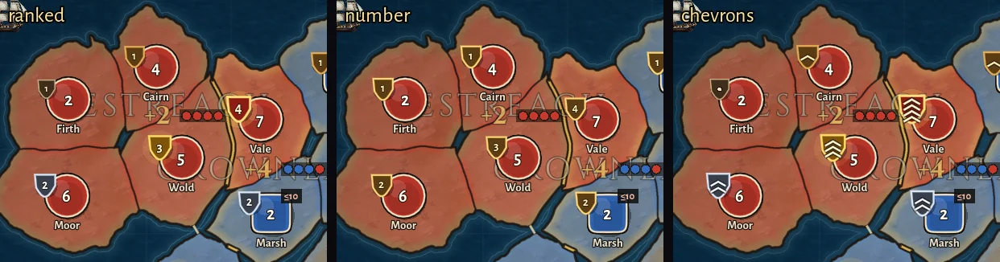
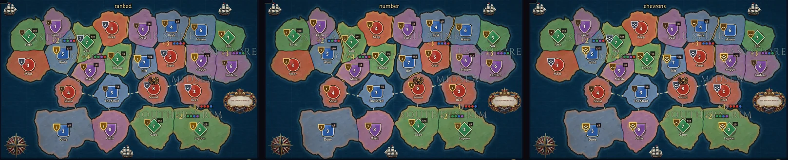
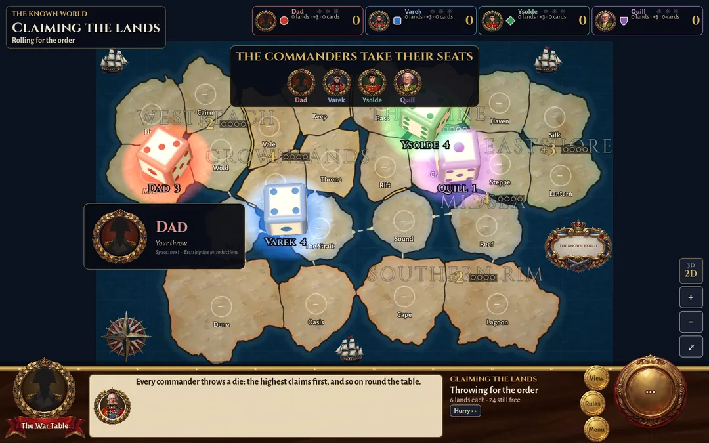

# v2.4: the map and its table (v24-map)

Seven of Alex's notes on v2.3.1 (`017a215`), all on the client: no rule changes and no rules bump (new games
still play rules 22). Branch `claude/v24-map-49317c`. The facts: `tests/test_v24m.gd` (15) and the probe
`tools/shots/v24m.gd` (58). No Ludo credits spent.

## What changed

**1. The music waits for the intro film.** ("the in-game music begins playing as soon as a new game is started
over the sounds of the intro cutscene.") A new war's first phase used to start the plan music, then play the
film over it. Now the setup screen's music fades out as the film starts, and the war's music and the tent's
sounds start when the film ends or is skipped. Without a film (Settings: films off, the tutorial, a loaded war)
the music starts at once, as before. The advisor's spoken counsel also waits until the film and the
introductions are done. On a dealt war it used to speak over the film. (`game_screen.gd` `_start_intro`,
`_on_phase`, `_update_counsel`)

**2. OK lets go of the land.** ("pressing 'ok' after moving troops through a left click -> left click action
should deselect the source region.") OK on an order's card, and Enter, now keep the order, close the card *and*
deselect the land it came from. This covers attacks, surges and the regroup's marches. Before, the source stayed
selected, so the next click on a land beside it ordered another attack or march from there. The card's ✕ and
Esc still only close the card, so there's a way to keep the land picked. (`game_screen.gd` `order_done`,
`order_card.gd`)

**3. The "left bare" warning counts only other threats.** ("only fire if there is another adjacent region that
you could be attacked by outside of the one you're invading.") `session.gd` `warnings()` now leaves out every
neighbour the land is marching on, not just one. A land that sends columns at two neighbours fears neither: an
enemy it attacks has to beat its column on the border before it could walk in. It's still warned about an enemy
next door that it leaves alone, including one that another of your lands is attacking (those two columns never
meet). The advisor's spoken "vacate" warning comes from the same list, so it no longer nags about the land
you're invading. (`warnings()` only)

**4. A loaded war comes back on the view it was left on.** ("loading a game brings it into 2d, it should resume
on whichever view it was, with the 2d/3d side button reflecting that choice.") Cause: the 3D land is rebuilt in
the background when a war is loaded. That took 2.2–2.6 s here (130–157 frames on The Known World), longer on a
slower machine. Meanwhile the board showed the flat chart with the chip reading "2D", and then the land rose
into 3D. A click on "2D" to get back to 3D turned the land off for good. Now:
- A war picked up on the land shows a dark "Laying out the land…" veil over the board (the HUD stays), then goes
  straight onto the land. It doesn't rise from the chart. The veil gives up after 20 s if the land never comes.
- A war picked up on the chart comes back on the chart. Pressing L later still raises the land from the chart,
  as ever, with no veil.
- The chip shows both words with the current view lit ("3D" big and gold over a small "2D", or the other way
  round). It used to show the other view, the one you'd switch to, which read as where you were.

The view is still the player's setting (`map_land`, L or the chip), so a loaded war comes back on the last view
you used, not one saved with the war. (`main.gd` `continue_game`, `game_screen.gd` `_veil_land`, `_land_up`,
`_land_chip_text`)

**5. Who's there, who's leaving, who's coming in.** ("it can be confusing when the game displays '1' or '2'
units in region you are moving troops into, thinking you can execute a move order with troops that haven't yet
arrived.") In the regroup phase the board drew the lands as they'd stand after the marches, so the number on a
land counted the men marching in, and they can't march on. Now:
- The token's big number is the men who are there and can still march. It agrees with `can_move_from`, the
  rules' own count.
- The men marching in ride a tab of their own: "+5" on a dashed edge in your colour (a march is dashed), with a
  small arrow pointing into the land. The tab sits on whichever side of the token the march arrows don't use, so
  it never covers the head of the arrow coming in.
- The men marching out were already right: the source's number drops, and the arrow carries the count.
- The tooltip spells it out: "Dad · 1 army · 1 in the garrison" then "5 marching in: they stay put this phase"
  (or "5 marching out"). The land card says "1 army · 1 in the garrison · +5 marching in".

The planning phase is unchanged: recruits placed there *can* attack the same round, so they stay in the number
(the gold "+n"). (`map_board.gd` `arriving`, `shown_split`, `_draw_arriving`, `_clear_spot`; `land_tip.gd`;
`land_card.gd` `_rebuild_maneuver`)

**6. The introductions are part of the roll for the order.** ("move the introductions of the characters from
its own screen to just before and while the initial dice are being rolled to see who goes first.") The separate
"The commanders take their seats" screen is gone. On a new war with lands claimed in turn (Standard):
- After the film, the claims panel reads THE COMMANDERS TAKE THEIR SEATS, and the advisor says his line about
  the roll.
- Each rival in turn gets a card on the war table: face, name, manner and level, and their greeting in their own
  voice. Their die drops in their colour while they speak.
- The card hangs near where that die comes to rest (the fall is worked out at the throw), on whichever side
  covers none of the dice already down.
- The faces strip dims everyone still to sit. Your own card ("Your throw") comes last, so the throws build to
  yours.
- Then the ties throw again and the order of claims stands, as before.
- Space, Enter or a click on the card moves to the next commander once their die is down. Esc skips the rest:
  whoever hasn't thrown throws now, all together.

Under the dice: the dice are thrown one at a time on the one dice stage, and each die is kept on the table as a
picture of that stage once it's down, so the next can fall. A stage per commander would be a 3D world per
commander. The names under the dice are now the last word ("Varek 4"). With every die on the table at once,
"Grand Marshal Varek" ran into his neighbour's.

On a war whose lands are dealt (no roll), the rivals step up the same way, without dice, in the middle of the
map before the deployment. The board waits for them: a click says so and tells you how to skip. Then the
DEPLOYMENT banner shows (that war's first deployment never had one). (`intro.gd` is now the card;
`game_screen.gd` `_seat_*`, `_draft_*`)

**7. The garrison shield shows how deep it's dug in.** ("try with/without the number inside and see what you
think.") Three looks, switchable in a war with **G** (Settings key `shields`):
- **ranked** (my pick, the default): the shield is dressed by its depth. Plain dark wood for the one man held
  back on a land nobody has dug in yet, then a brass rim for one dug in, steel for two, gold for three, and gold
  on crimson with a glow for a fortress's or capital's four. The number stays inside.
- **number**: the shield as it was, the same look whatever the depth, with the number inside.
- **chevrons**: dressed the same way, with a chevron for each man dug in instead of the number. A small boss
  stands for the man held back.

Close up, on Dad's lands (Firth 0 dug in, Cairn 1, Moor 2, Wold 3, Vale 4) beside Varek's:

The whole Known World mid-deployment (two to eight men a land, nought to three dug in), for the noise:

**Why ranked:** it keeps the exact number, so nothing anyone reads today goes away. It adds the depth at a
glance: the gold and crimson strongholds stand out across the whole map, and so does the plain wood of a land
held by one man nobody dug in. And it adds no new mark to the token, only the shield's own colours (a tier is a
little bigger, a few px at most). Chevrons look the part close up, but over the whole map two stripes and three
blur together, the number is gone, and the boss is one more symbol to learn. If ranked reads as noise in play,
G goes back to the old shield, and so does `"shields": "number"` in the defaults.

**To compare:** press **G** in a war (a toast names each look), or run `SHOT_DIR=/some/dir ./scripts/shot.sh
v24m`, which writes both side-by-sides (`22_shields_side_by_side.png`, `23_whole_map_side_by_side.png`) and a
shot of each look.

The roll, as it looks now (every die down, your own throw last):

## Tests and probes

- `tests/test_v24m.gd` (registered in `tests/runner.gd` after the AI tests, away from where test_v24 goes):
  - The warning: the land you invade isn't counted; two columns from one land, no warning; an enemy beside it
    that another of your lands attacks still counts; keeping 2 never warns; neutral never counts.
  - `MapBoard.shown_split` against the march rules.
  - The regroup tooltip.
- `tools/shots/v24m.gd`, 58 facts:
  - 1: the music during and after the film.
  - 6: the seats, one at a time; the dice; the strip; your throw last; the card on the table inside 1440×900;
    the card keeping clear of the dice; Esc; the dealt war.
  - 2: OK, Enter and ✕.
  - 3: the warning and the advisor's dispatch.
  - 5: the tab, the number, the tooltips and the land card.
  - 7: each look's facts, G, and the side-by-sides.
  - 4: the veil, the land at once, the chip, the chart, and L afterwards (no veil).
- The probe uses a save of its own (`user://probe_v24m_savegame.json`). Every worktree on this PC shares
  `user://`, and on one run its Continue picked up another session's war from `probe_savegame.json`. Worth
  knowing for any probe that saves and continues while other sessions run probes.
- The old screen's `intro._done()`, which nearly every probe calls to skip the introductions, still works: it
  skips the seats (the rest throw together).
- `./scripts/check.sh` is green, and so is the full suite (`./scripts/test.sh`: 756 passed, 0 failed).
  `./scripts/probes.sh`, every probe on this PC: all 33 green (v24m 58 facts, 21 shots). After the last change
  (one glow disc instead of three, the tab's border in 4 dashed lines), v24m and v114 were run again: green.

## Draw calls a token makes

Counted from the code (each `draw_*` call is one canvas command; `Style.draw_shape` is two: the polygon and its
edge). v24-3d measured these at 17-33 µs each on the land, times every token on the map. My token changes stay
inside `_draw_token` and its helpers (`_draw_shield`, `_shield_number`, `_draw_arriving`, `_clear_spot`,
`shown_split`), with no cache of their own: v24-3d is caching the token's drawing on top of this.

| a held land's token, nothing else on it | before | after |
|---|---|---|
| on the chart (name 2, drop shadow 1, border 2, body 2, sheen 2, highlight 1, number 2, shield 5) | 17 | 17 |
| on the land (adds the ground shadow 3, the thickness 4) | 24 | 24 |
| ranked, three or four dug in: one soft glow disc behind the shield | 17 / 24 | **18 / 25** |
| number (the old shield) | 17 / 24 | 17 / 24 |
| chevrons: the boss / 1 / 2 / 3 / 4 dug in (2 lines a chevron, the glow at 3 and 4) | 17 / 24 | 17 / 17 / 19 / 22 / 24 on the chart, +7 on the land |
| the regroup's "+N marching in" tab, only on the lands receiving a march | (none) | **+9** (2 rects, 4 dashed lines, the arrow's line and head, the text) |

So the default (ranked) adds one call on the deeper garrisons and nothing else. The glow was three discs until
I trimmed it to one for this. Unchanged and worth v24-3d's look while they're there: a land that holds the road
home wears a dashed amber ring drawn as 16 separate arcs.

## What Alex should poke at

1. Start a new Standard war with films on. Is the film quiet of war music, and does the plan theme start the
   moment it ends or you skip it?
2. Watch the rivals take their seats. Is the pace right: one greeting each, their die falling as they speak?
   Try Space to hurry, and Esc to skip. Does your own throw land well as the last one?
3. A dealt war (Recruit or Classic): the rivals step up before the deployment. Does that still feel welcome, or
   should a dealt war skip it?
4. Click a land, click an enemy, press OK: the land should be let go. Try ✕ too (it keeps the land picked).
5. In the regroup phase, march into a land and read its token: the number, then "+N" on its tab.
6. Play a few rounds in 3D, quit, Continue: a moment of "Laying out the land…", then the land, and the chip on
   3D. Then the same on the chart.
7. Press G a few times in a war and pick a shield.

## Open questions for Alex

1. **Shields:** keep ranked as the default, or would you rather have the number shield or chevrons?
2. **The G key:** keep it for good, or take it out once the shield is chosen?
3. **The advisor's roll line** ("Every commander throws a die…") still plays before the first rival sits, about
   5 s. Keep it, or let the bar's text say it and get to the rivals sooner?
4. **Dealt wars:** keep the rivals' cards before the deployment, or go straight to it?

## For the coordinator

- **Outside my list:** `game/ui/land_card.gd`, which isn't in anyone's list (the regroup line, item 5, three
  lines). `intro.gd` counts as the intro UI. Everything else is in my list.
- **The bonus labels are v24-3d's:** as you asked, `_draw_region_labels`, `_bonus_spot` and the bonus caches are
  exactly as they were at `017a215` on this branch. I'd applied v24-3d's patch for them (their measured fix for
  the swoop's chug) before your message; the second commit takes it back out, so it lands from their branch
  only. I checked their pruning on the way: a skipped spot has a hit and costs at least the best on the
  region's own lands, so it could never win, and the result is the same. I've told them it's theirs again.
- **For v24-battles' text, if ranked ships:** How to Play ("Every land keeps a garrison: the men on the gold
  shield beside its number…") and `README.md` line 41 ("The gold shield on a land is its garrison…") call the
  shield gold. A suggested line: "the shield beside its number (plain wood for the one man held back, brass,
  steel, then gold the deeper they dig in)". If G stays, the README's controls table could add a row:
  "Garrison shields | G steps through how the shields show their depth". README line 83 already calls the chip
  "the 3D / 2D chip", which is now what it shows. How to Play doesn't describe the bare-land warning (item 3),
  so nothing to change there.
- **CHANGELOG material:** the seven items above. No B-numbers: none of the open bugs were in this list.
- **PLAYTEST material:** "What Alex should poke at" above.
